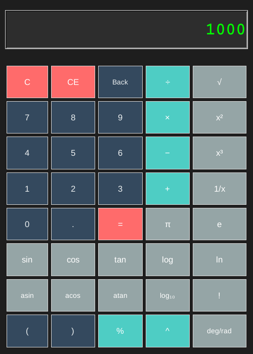

<div align="center">

# 🧮 Scientific Calculator (Python + Tkinter)

A dark-themed desktop scientific calculator written in pure Python with Tkinter. No third-party packages.




</div>

---

## Features

| Group | Buttons |
|---|---|
| Arithmetic | `+` `−` `×` `÷`, `^` (power), `%` (remainder), parentheses `(` `)` |
| Powers and roots | `x²`, `x³`, `√`, `1/x` |
| Trigonometry (degrees) | `sin`, `cos`, `tan`, `asin`, `acos`, `atan` |
| Logarithms | `log` (base 2), `log₁₀`, `ln` |
| Other | `!` (factorial), constants `π` and `e` |
| Editing | `C` (clear), `CE` (clear entry), `Back` (delete last character) |

**Input checks and error messages**
- Blocks two operators in a row and a second decimal point in one number
- Clear messages for division by zero, square root of a negative, log of a non-positive number, `asin`/`acos` outside [-1, 1], mismatched parentheses and incomplete expressions
- Factorial limited to whole numbers from 0 to 170 (larger values overflow a float)
- Results rounded to 10 decimal places
- Expressions are evaluated with `eval` in a restricted namespace (no built-ins), so only arithmetic can run

**Interface**
- 500 × 700 dark window with a large green display
- Colour-coded buttons: red for clear/equals, teal for operators, grey for scientific functions, dark blue for digits

## How to use

- Build an expression with the digit, operator and bracket buttons, then press `=`.
- The scientific buttons (`sin`, `√`, `x²`, `log`, `!` …) act **on the number currently shown**. For example, type `90` then press `sin` to get `1.0`, or type `5` then press `!` to get `120`.
- Trigonometric functions use **degrees**.

| You press | Display shows |
|---|---|
| `125 × 8 =` | `1000` |
| `2 ^ 10 =` | `1024` |
| `( 4 + 5 ) × 2 =` | `18` |
| `90` then `sin` | `1.0` |
| `100` then `log₁₀` | `2.0` |
| `16` then `√` | `4.0` |

## Getting started

**Requirements:** Python 3.8 or newer with Tkinter (included in the standard Windows and macOS installers).

```bash
git clone https://github.com/ZainAftab-dev/Scientific-Calculator.git
cd Scientific-Calculator
python scripts/scientific_calculator.py
```

If Python says `No module named 'tkinter'`:

| OS | Fix |
|---|---|
| Windows / macOS | Reinstall Python from python.org and keep "tcl/tk and IDLE" ticked |
| Ubuntu / Debian | `sudo apt install python3-tk` |
| Fedora | `sudo dnf install python3-tkinter` |

## Project structure

```
Scientific-Calculator/
├── scripts/
│   └── scientific_calculator.py   # ScientificCalculator class: display, buttons, event handling, evaluation
└── docs/
    └── screenshot.png
```

## Known limitations

- Mouse input only (no keyboard shortcuts yet)
- The `deg/rad` button only shows the current mode; all trig functions work in degrees
- No calculation history

## Roadmap

- Keyboard input
- Working radian mode
- Calculation history panel

## Author

**Zain Aftab** · [GitHub](https://github.com/ZainAftab-dev) · [LinkedIn](https://www.linkedin.com/in/zain-aftab-563727295/)

## License

[MIT](LICENSE)
